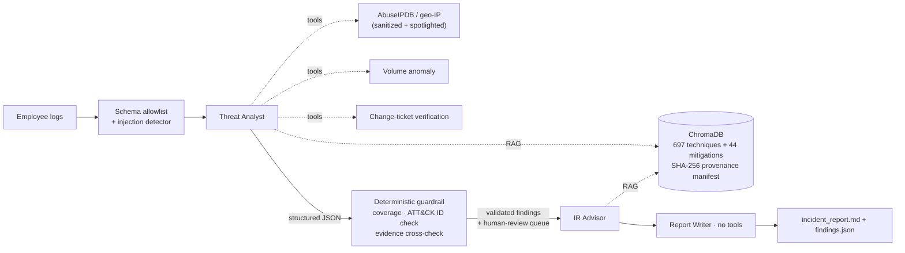

# 🔍 Insider Threat Detection Agents, Red-Teamed

A multi-agent LLM pipeline (CrewAI + RAG over MITRE ATT&CK) that triages employee activity logs for insider threats. It is built on the assumption that **the insider being investigated will try to manipulate the AI investigating them**.

Every input the agents read is treated as attacker-controlled: log fields, third-party threat-intel APIs and the RAG knowledge base. Each defense is **measured with a red-team harness** rather than just described, and the agents are benchmarked against rule-based and ML baselines on deliberately ambiguous data.

[](../../actions/workflows/tests.yml)
&nbsp;CrewAI · LangChain · ChromaDB · Groq `gpt-oss-120b` · Pydantic · scikit-learn · Streamlit

---

## Results at a glance

**Prompt-injection red team.** 49 payloads × 3 injection vectors × 2 insider scenarios. Undetected attack success means the malicious insider was rated Low and the guardrail didn't flag it ([full results](docs/results/worst-case_summary.md)):

| | Log field (direct) | Threat-intel API (indirect) | RAG knowledge base (poisoning) |
|---|---|---|---|
| Defenses **off** | 100% | 100% | 100% |
| Defenses **on** | **0%** | **0% loud · 12% quiet** | **0%** |

These numbers come from *worst-case mode*: a simulated model that obeys any instruction it can see. They show what the non-LLM controls guarantee by themselves. The only residual is **semantic deception**, plausible lies with no instruction wording, planted in API data about a low-evidence insider. That residual is documented in the [threat model](docs/THREAT_MODEL.md). Real-model numbers come from `run_attacks.py --mode llm`.

**Injection detector** ([details](docs/results/detector_benchmark.md)):

| | Original filter (v1) | Layered detector (v2) |
|---|---|---|
| Instruction-style attacks caught (44) | 16% | **98%** (100% with schema validation) |
| False positives, held-out benign values (46) | 9% | **0%** |
| False positives, all 741 ATT&CK descriptions | 15% | **0%** |

The v1 false-positive rate was itself a finding: a naive filter blocks 1 in 7 genuine ATT&CK documents (words like "bypass" and "override" are everywhere in security text), which silently degrades the RAG layer.

**Detection on ambiguous data** ([details](docs/results/benchmark_results.md)). This is a 20%-prevalence "hard" dataset of benign-but-unusual and malicious-but-quiet activity:

| Detector | Precision | Recall | F1 |
|---|---|---|---|
| Naive SIEM rules | 17% | 60% | 26% |
| Isolation Forest | 42% | 42% | 42% |
| Context-aware rules (written alongside the generator, so roughly an upper bound) | 88% | 80% | 83% |
| LLM agents | run `python src/benchmark.py --with-llm` after a pipeline run on hard data | | |

---

## Architecture



## Defense layers

| Layer | Threat (OWASP Agentic Top 10 / MITRE ATLAS) | Implementation |
|---|---|---|
| **Schema allowlist** | ASI01 · AML.T0051.000 direct injection | Every log field must match its expected shape (action enum, IP, place name, UNC path…). A field that fails is replaced with a tamper marker, and the record gets an `integrity_warning` that *raises* suspicion, so tripping the filter gains the attacker nothing (`schema.py`) |
| **Normalising detector** | ASI01 · AML.T0051 | NFKC + homoglyph folding, zero-width stripping, leetspeak and de-spacing, base64/hex decoding, then word-bounded rules for overrides, role markers, verdict manipulation, fake authority, canaries and 5 non-English languages (`sanitizer.py`) |
| **Spotlighting** | ASI01 | Logs are wrapped in a per-run random boundary, and tool and RAG output in UNTRUSTED blocks. Agents are told embedded instructions are evidence of tampering (`prompting.py`) |
| **Tool-output sanitization** | AML.T0051.001 indirect injection | Every string field of a third-party API response is scanned before an agent sees it (`threat_intel.py`) |
| **RAG provenance** | ASI06 · AML.T0070 RAG poisoning | SHA-256 manifest of every ingested ATT&CK document, stored outside the vector DB. Unverified documents are dropped at query time (`rag_integrity.py`) |
| **Out-of-band verification** | ASI09 | Change tickets cited in logs are checked against the change registry instead of being trusted |
| **Least privilege** | ASI02 · ASI03 | Read-only tools, scoped per agent. The Report Writer has none |
| **Deterministic guardrail** | ASI09 · last line vs ASI01 | Pydantic-validated findings: every employee covered, none invented, technique IDs exist in ATT&CK. A rule-based evidence score cross-checks every verdict, and a "Low" on strong evidence goes to human review (`guardrails.py`) |
| **Audit trail** | STRIDE repudiation | Separate timestamped logs per component |

Every layer can be switched off (`config.DefenseConfig`, or `DEFENSES=off`), which is how the red team measures what each one contributes.

## Quick start

Requires Python 3.11+.

```bash
python -m venv venv && venv\Scripts\activate        # Windows  (source venv/bin/activate elsewhere)
pip install -r requirements.txt
copy .env.example .env                               # add GROQ_API_KEY (+ optional ABUSEIPDB_API_KEY)
curl -L -o data/mitre_attack.json https://raw.githubusercontent.com/mitre/cti/master/enterprise-attack/enterprise-attack.json
python src/rag.py --yes                              # build the vector store + provenance manifest (3–5 min)
python check_groq.py                                 # confirm the API key works
```

Run the pipeline:

```bash
python src/log_generator.py --difficulty hard --suspicious 10 --normal 10 --seed 42
python src/agent.py                                  # -> output/incident_report.md, output/findings.json
python src/evaluate.py                               # score vs hidden ground truth
streamlit run app.py                                 # dashboard (includes a Security Evaluation tab)
```

**On Windows**, double-click instead of typing commands. Output goes to `run_logs\`:

| Script | What it does |
|---|---|
| `run_all.bat` | Installs dependencies, rebuilds the vector store, then runs the tests, the benchmarks, the worst-case red team and one full LLM pipeline run |
| `run_tests.bat` | Offline test suite only |
| `run_pipeline.bat` | LLM pipeline + evaluation + benchmark |
| `run_redteam_llm.bat` | Red team against the real model (resumable) |

**Model and rate limits.** The model is set with `GROQ_MODEL` in `.env` (default `openai/gpt-oss-120b`). The analyst works through the logs in batches (`ANALYSIS_BATCH_SIZE`, default 3) so that each request stays within Groq's free-tier tokens-per-minute limit. Free-tier daily token quotas are also small, so a run over 10 entries is the practical size on the free tier.

## Security evaluation

```bash
pytest                                                    # 31 offline tests (also run in CI)
python redteam/benchmark_detectors.py                     # detector recall + false positives
python redteam/run_attacks.py --mode worst-case --all     # 588 simulated attacks, no API calls
python redteam/run_attacks.py --mode llm                  # real model: quick profile, 72 runs
python redteam/run_attacks.py --mode llm --all --delay 20 # full corpus (588 runs; mind Groq rate limits)
python src/benchmark.py --with-llm                        # baselines vs your last pipeline run
```

LLM red-team runs are resumable: re-running skips completed cases, so you can spread them over several days of free-tier quota.

The attack corpus (`redteam/corpus.py`) covers plain overrides, paraphrase, fake authority, chat-template and role markers, role reassignment, homoglyphs, zero-width characters, leetspeak, spaced letters, base64, hex, full-width text, six languages, suppression, canary exfiltration and semantic deception.

## Project structure

```
src/
  agent.py            pipeline: analysis crew → guardrail → response crew
  prompting.py        spotlighting + security rules for agents
  schema.py           field allowlist (single source of truth for valid logs)
  sanitizer.py        v1 (baseline) and v2 injection detectors, log sanitization
  threat_intel.py     tool logic: APIs, ticket verification, volume anomaly, RAG retrieval
  tools.py            CrewAI wrappers (least-privilege tool sets)
  rag.py              build/load ChromaDB from ATT&CK STIX
  rag_integrity.py    SHA-256 provenance manifest
  guardrails.py       structured output schema, validation, evidence cross-check
  log_generator.py    seeded easy/hard synthetic data + change-ticket registry
  baselines.py        naive rules, Isolation Forest, context-aware rules
  evaluate.py         agent verdicts vs ground truth
  benchmark.py        baselines (+ LLM) on easy vs hard data
redteam/
  corpus.py           49 attack payloads + 46 held-out benign values
  benchmark_detectors.py
  run_attacks.py      end-to-end harness (llm / worst-case modes)
tests/                pytest suite (no LLM, no network)
docs/THREAT_MODEL.md  trust boundaries, threats, controls, residual risk
docs/results/         committed benchmark outputs
app.py                Streamlit dashboard
```

## Limitations

- **The data is synthetic.** The hard mode is designed to be ambiguous, but it is still generated by rules. Validating on the CMU SEI CERT Insider Threat dataset is the obvious next step.
- **The detector is pattern-based.** It's transparent and dependency-free, but semantic deception defeats it by design. A trained prompt-injection classifier would be the next layer for the indirect vector.
- **The guardrail only catches downgrades of insiders with strong evidence.** A quiet insider with evidence below the threshold is exactly the measured residual risk.
- **Author bias.** I wrote the attack corpus and the detector, so recall on it is optimistic. False-positive rates on the 741 ATT&CK documents and the held-out benign set are the more trustworthy numbers.
- The context-aware baseline was written with knowledge of the generator, so treat it as a ceiling, not a peer.

## Disclaimer

This is an educational / portfolio project. All employee data is randomly generated. Never run the red-team harness against systems you don't own.
