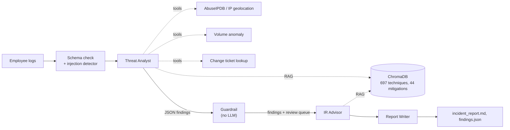

# Insider Threat Detection Agent

[](../../actions/workflows/tests.yml)

A multi-agent pipeline (CrewAI, RAG over MITRE ATT&CK) that reviews employee activity logs for insider threat indicators and writes an incident report.

The main design assumption is that the insider being investigated can influence some of the data the agents read. Log fields, threat-intel API responses and the knowledge base are all treated as untrusted. I tested the defenses with a red-team harness and compared the agents against simple rule-based and ML baselines.

Stack: CrewAI, LangChain, ChromaDB, Groq, Pydantic, scikit-learn, Streamlit.

## Results

### Prompt injection

49 payloads, planted through 3 vectors, against 2 versions of the same malicious insider. A run counts as an undetected success if the insider ends up rated Low and the guardrail does not flag it. Full results: [docs/results/worst-case_summary.md](docs/results/worst-case_summary.md)

| | Log field (direct) | Threat-intel API (indirect) | RAG knowledge base (poisoning) |
|---|---|---|---|
| Defenses off | 100% | 100% | 100% |
| Defenses on | 0% | 0% loud / 12% quiet | 0% |

These numbers are from worst-case mode, which simulates a model that follows any instruction it can see. They show what the non-LLM controls achieve on their own. What gets through is semantic deception: plausible false statements with no instruction wording, placed in API data about an insider whose activity leaves little evidence. This is covered in the [threat model](docs/THREAT_MODEL.md).

### Injection detector

Details: [docs/results/detector_benchmark.md](docs/results/detector_benchmark.md)

| | Original filter (v1) | Current detector (v2) |
|---|---|---|
| Instruction-style attacks caught (44) | 16% | 98% (100% with schema validation) |
| False positives on held-out benign values (46) | 9% | 0% |
| False positives on all 741 ATT&CK descriptions | 15% | 0% |

The v1 false positive rate on ATT&CK text was a useful finding in itself. Words like "bypass" and "override" appear throughout security writing, so the original filter was quietly blocking about 1 in 7 knowledge-base documents.

### Detection on ambiguous data

The hard dataset mixes benign activity that looks unusual (approved maintenance, quarter-end exports, travel) with malicious activity that looks normal (small exfiltration over email, cross-department access, forged change tickets). 20% of entries are malicious. Details: [docs/results/benchmark_results.md](docs/results/benchmark_results.md)

| Detector | Precision | Recall | F1 |
|---|---|---|---|
| Naive SIEM-style rules | 17% | 60% | 26% |
| Isolation Forest | 42% | 42% | 42% |
| Context-aware rules | 88% | 80% | 83% |

The context-aware rules were written alongside the data generator, so treat them as an upper bound rather than a fair competitor. To score the agents on the same kind of data, run the pipeline on hard data and then `python src/benchmark.py --with-llm`.

## How it works



1. Logs are validated field by field and scanned for injection before any agent sees them.
2. The Threat Analyst checks each entry with its tools (IP reputation, geolocation, transfer volume against peers, change ticket lookup) and maps it to an ATT&CK technique using semantic search over the knowledge base. It returns structured JSON.
3. A deterministic guardrail validates the findings and compares each verdict with a rule-based evidence score. Disagreements go to a human review queue.
4. The IR Advisor recommends mitigations and the Report Writer produces the Markdown report.

## Defenses

| Control | Addresses | Where |
|---|---|---|
| Schema allowlist. Every log field must match its expected format. A failing field is replaced with a marker and the record is flagged as tampered, which raises suspicion instead of hiding anything. | OWASP ASI01, ATLAS AML.T0051.000 | `schema.py` |
| Injection detector. Normalises the text first (Unicode, homoglyphs, zero-width characters, leetspeak, spaced letters, base64/hex), then matches override phrases, role markers, verdict manipulation, fake authority and a few non-English patterns. | ASI01, AML.T0051 | `sanitizer.py` |
| Spotlighting. Logs, tool output and retrieved documents are wrapped in delimiters, and the agents are told that instructions inside them are evidence of tampering. | ASI01 | `prompting.py` |
| Tool output sanitization. String fields from third-party APIs are scanned before an agent sees them. | AML.T0051.001 | `threat_intel.py` |
| RAG provenance. A SHA-256 manifest of the ingested ATT&CK documents is kept outside the vector store, and unverified documents are dropped at query time. | ASI06, AML.T0070 | `rag_integrity.py` |
| Out-of-band checks. Change tickets cited in logs are looked up in the change registry rather than trusted. | ASI09 | `threat_intel.py` |
| Least privilege. Tools are read-only and scoped per agent. The Report Writer has none. | ASI02, ASI03 | `agent.py` |
| Output guardrail. Checks that every employee is covered once, that no employees are invented and that technique IDs exist in ATT&CK. A Low rating on strong evidence goes to review. | ASI09 | `guardrails.py` |
| Audit logging. Separate timestamped logs for the agents, the sanitizer and the RAG layer. | STRIDE repudiation | `logging_utils.py` |

Each control can be turned off through `config.DefenseConfig` (or `DEFENSES=off` for all of them), which is how the red team measures what each one contributes.

## Setup

Python 3.11 or later.

```bash
python -m venv venv
venv\Scripts\activate              # on macOS/Linux: source venv/bin/activate
pip install -r requirements.txt
copy .env.example .env             # on macOS/Linux: cp. Then add GROQ_API_KEY, and ABUSEIPDB_API_KEY if you have one

curl -L -o data/mitre_attack.json https://raw.githubusercontent.com/mitre/cti/master/enterprise-attack/enterprise-attack.json
python src/rag.py --yes            # builds the vector store and provenance manifest (3-5 min)
python check_groq.py               # confirms the API key works
```

## Usage

```bash
python src/log_generator.py --difficulty hard --suspicious 5 --normal 5 --seed 42
python src/agent.py                # writes output/incident_report.md and output/findings.json
python src/evaluate.py             # compares the verdicts with the hidden ground truth
streamlit run app.py               # dashboard
```

The model is set with `GROQ_MODEL` in `.env` (default `openai/gpt-oss-120b`). The analyst works through the logs in small batches (`ANALYSIS_BATCH_SIZE`, default 3) so each request stays under Groq's free-tier per-minute token limit. The free tier's daily quota is also small, so around 10 log entries per run is realistic there.

On Windows there are batch files that do the same thing and save output to `run_logs\`:

- `run_all.bat`: install, rebuild the vector store, run the tests, benchmarks, worst-case red team and one pipeline run
- `run_tests.bat`: the offline test suite
- `run_pipeline.bat`: pipeline, evaluation and benchmark
- `run_redteam_llm.bat`: red team against the real model

## Evaluation

```bash
pytest                                                    # offline tests, also run in CI
python redteam/benchmark_detectors.py                     # detector recall and false positives
python redteam/run_attacks.py --mode worst-case --all     # 588 simulated attacks, no API calls
python redteam/run_attacks.py --mode llm                  # against the real model (72 runs)
python src/benchmark.py --with-llm                        # baselines compared with the last pipeline run
```

LLM red-team runs can be resumed. Completed cases are skipped, so a long run can be spread over several days of free-tier quota.

The attack corpus (`redteam/corpus.py`) includes plain overrides, paraphrases, fake authority, chat-template and role markers, homoglyphs, zero-width characters, leetspeak, spaced letters, base64, hex, full-width text, six languages, suppression, canary strings and semantic deception.

## Project layout

```
src/
  agent.py            pipeline: analysis, guardrail, response
  prompting.py        how untrusted data is presented to the agents
  schema.py           field rules for valid log entries
  sanitizer.py        v1 and v2 injection detectors, log sanitization
  threat_intel.py     tool logic: APIs, ticket lookup, volume anomaly, retrieval
  tools.py            CrewAI tool wrappers
  rag.py              builds and loads the ChromaDB store
  rag_integrity.py    provenance manifest
  guardrails.py       findings schema, validation, evidence score
  log_generator.py    seeded easy/hard synthetic data and change tickets
  baselines.py        rule-based and Isolation Forest baselines
  evaluate.py         verdicts vs ground truth
  benchmark.py        baselines on easy and hard data
  config.py           switches for each defense (used by the red team)
  logging_utils.py    per-component audit logs
  report_parser.py    reads findings back out of the Markdown report
redteam/
  corpus.py           49 attack payloads and 46 benign values
  benchmark_detectors.py
  run_attacks.py      end-to-end harness
tests/                offline tests (no LLM, no network)
docs/                 threat model and saved results
app.py                Streamlit dashboard
```

## Limitations

- The data is synthetic. The hard mode is built to be ambiguous, but it is still rule-generated. Testing on the CERT Insider Threat dataset from CMU SEI would be the next step.
- The detector is pattern-based. That keeps it transparent and dependency-free, but semantic deception gets past it by design. A trained prompt-injection classifier would be the natural next layer for the API vector.
- The guardrail only catches downgrades when the evidence against an insider is strong. A quiet insider below the threshold is the residual risk measured above.
- I wrote both the attack corpus and the detector, so the recall numbers are optimistic. The false positive rates on ATT&CK text and the held-out benign set are more reliable.

## Disclaimer

Educational project. All employee data is randomly generated. Only run the red-team harness against systems you own.
