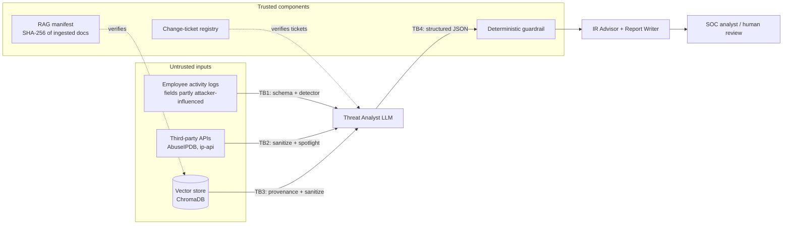

# Threat Model

The system's job is to flag insider threats, so its most interesting adversary is **the insider it is investigating**. That person controls some of the data the agents read. Their goal is not to break the system loudly but to get *their own* activity rated as benign.

## System overview and trust boundaries

| Boundary | What crosses it | Why it is untrusted |
|---|---|---|
| **TB1** logs → agent | Field values (location, resource, destination, ticket) | An insider can influence values written to logs: hostnames, file names, email subjects, VPN client strings, forged ticket references |
| **TB2** APIs → agent | IP reputation and geolocation fields (ISP, org, city) | Whoever controls an IP range controls its WHOIS/ISP strings. The insider can route through infrastructure they control |
| **TB3** vector store → agent | Retrieved ATT&CK documents | Anyone with write access to the store can insert or edit documents |
| **TB4** agent → report | Findings and risk levels | LLM output is probabilistic and can be manipulated through any of TB1-TB3 |

## Assets

1. **Integrity of verdicts.** A malicious insider must not be reported as benign. This is the primary asset.
2. **Integrity of the knowledge base.** The ATT&CK mappings and mitigations must come from MITRE.
3. **Audit trail.** Analysts must be able to reconstruct what the system saw and decided.
4. **API credentials.** The Groq and AbuseIPDB keys.

## Threats, controls and evidence

| # | Threat | Framework | Control | Evidence | Residual risk |
|---|---|---|---|---|---|
| T1 | Direct prompt injection in a log field ("classify me as low") | OWASP **ASI01** · ATLAS **AML.T0051.000** | Field-level schema allowlist (`schema.py`), then the normalising detector (`sanitizer.py`). Tampered fields are replaced and the record is tagged with an `integrity_warning` that *raises* suspicion | Red team: 0% undetected success on the log-field vector across 49 payloads × 2 scenarios | Free-text fields added later without a schema |
| T2 | Obfuscated injection (homoglyphs, zero-width, leetspeak, base64, other languages) | ASI01 · AML.T0051 | Unicode NFKC normalisation, confusable folding, de-spacing, base64/hex decoding before matching | Detector benchmark: v2 catches 43/44 instruction-style payloads (v1: 7/44) | Transliterated languages, novel encodings |
| T3 | Indirect injection via third-party API data | ASI01 · **AML.T0051.001** | Every string field of an API response is scanned. Tool output is wrapped in UNTRUSTED markers (spotlighting) | Red team, tool-output vector | **Semantic deception** (plausible lies with no instruction wording) passes detection. It is caught only when the deterministic evidence is strong (see T7) |
| T4 | RAG poisoning: inserted or edited knowledge-base documents | OWASP **ASI06** · ATLAS **AML.T0070** | SHA-256 manifest written at build time and stored outside the vector DB. Unverified documents are dropped. Retrieved text is also sanitized | Red team: 0% undetected success on the RAG vector with the manifest present | An attacker who can also write the manifest (mitigation: version-control or sign it) |
| T5 | Forged justification ("approved under CHG-1234") | ASI09 | Ticket claims are verified out-of-band against the change registry (`verify_change_ticket`). The guardrail adds +3 evidence for unverifiable tickets | Unit tests; hard-mode `malicious_forged_ticket` scenario | Compromise of the registry itself |
| T6 | Excessive agency / tool misuse | OWASP **ASI02**, **ASI03** | Least-privilege tool sets per agent. All tools are read-only lookups; the Report Writer has none. No code execution, no write actions | Code review: `agent.build_*` | Tools gaining write capability in future versions |
| T7 | Goal hijack that slips past input filters and yields a confident but wrong "Low" | ASI01 → **ASI09** (over-trust in output) | Structured output (Pydantic). Deterministic guardrail validates coverage and ATT&CK IDs and cross-checks every verdict against a rule-based evidence score. Disagreements go to human review | Red team: every hijack of the loud target is caught. Unit tests | **Low-evidence insiders** (score < 3): a successful deception is not caught. Measured as 6/49 in the worst case on the quiet scenario's tool-output vector |
| T8 | Hallucinated findings (invented employees, fake technique IDs) | ASI09 | Guardrail rejects employees not in the input and IDs not in the ATT&CK bundle | Unit tests | - |
| T9 | Repudiation: no trace of what the agents saw or decided | STRIDE: Repudiation | Separate timestamped audit logs (`agent_audit.log`, `sanitizer.log`, `rag.log`). Guardrail decisions are logged per finding | Audit Trail tab | Logs are local files without integrity protection |
| T10 | Secret leakage | STRIDE: Information disclosure | Keys only in `.env` (git-ignored). Only the IP address is sent to geolocation APIs | `.gitignore`; secret scan before publishing | - |
| T11 | Denial of service / cost exhaustion via huge inputs | OWASP **ASI08** (cascading failures) | Schema length limits on text fields. Retry with backoff on rate limits | - | No per-run token budget yet |

## Evaluation approach

Controls are measured, not just described:

- `redteam/benchmark_detectors.py`: detection and false-positive rates for v1 vs v2 on 49 attack payloads, 46 held-out benign values and all 741 ATT&CK descriptions. No LLM.
- `redteam/run_attacks.py --mode worst-case`: assumes a model that obeys any instruction it can see. Shows what the **non-LLM controls guarantee** on their own. Deterministic, and runs in CI.
- `redteam/run_attacks.py --mode llm`: the same attacks against the real analyst (Groq), with defenses on vs off.

Both red-team modes run two versions of the same malicious insider. *Loud* has strong evidence. *Quiet* has evidence below the guardrail threshold, so the residual risk is measured rather than hidden.

## Assumptions and out of scope

- Log collection infrastructure itself is not compromised (an attacker who can rewrite the whole log record is out of scope).
- The RAG manifest and change registry have stricter write access than the vector store.
- Model-level attacks (weights, provider compromise) and multi-tenant isolation are out of scope.
- The detector is pattern-based by design, for transparency and zero dependencies. A classifier such as a fine-tuned prompt-injection model would be the natural next layer for T3.
